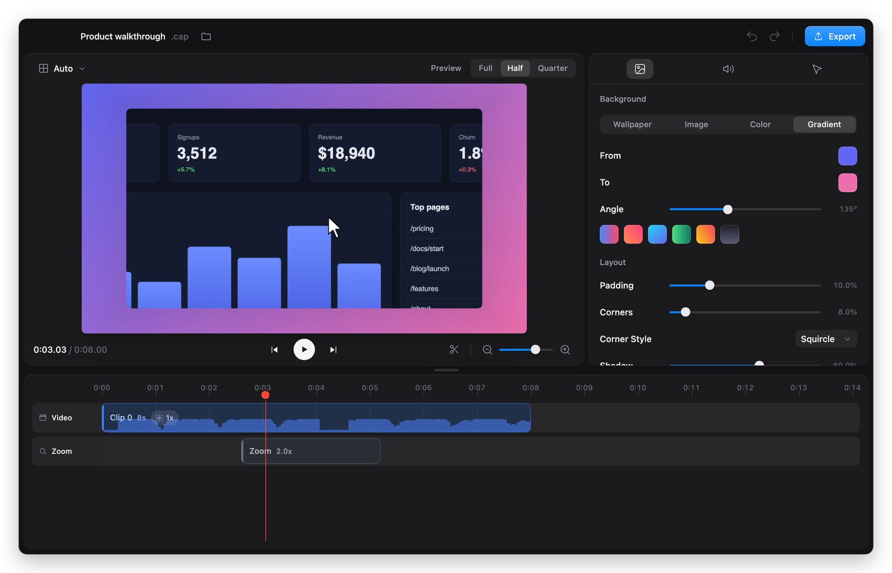
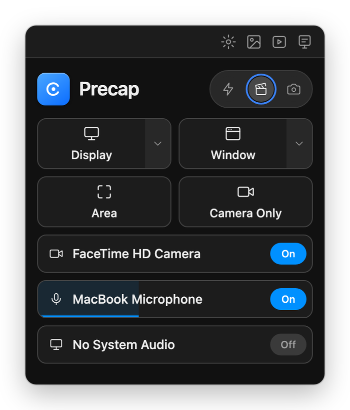
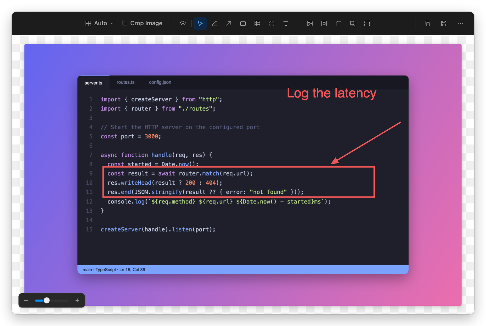
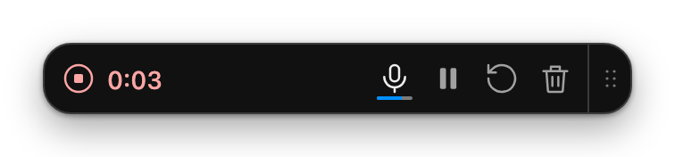
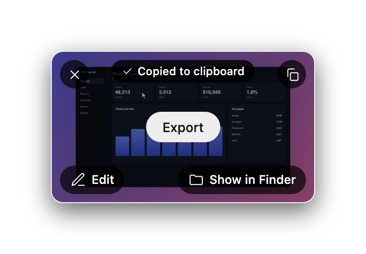
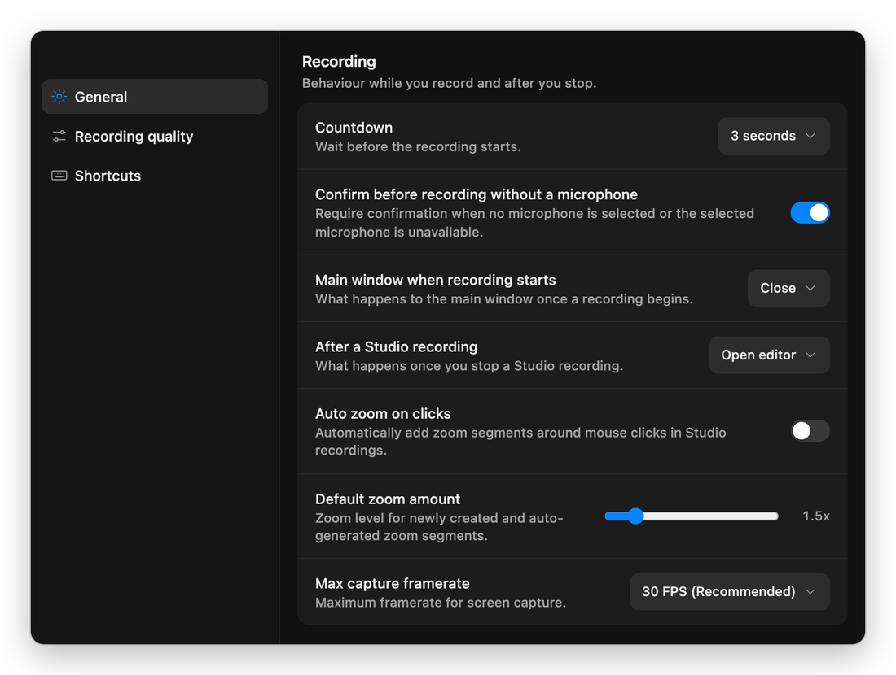
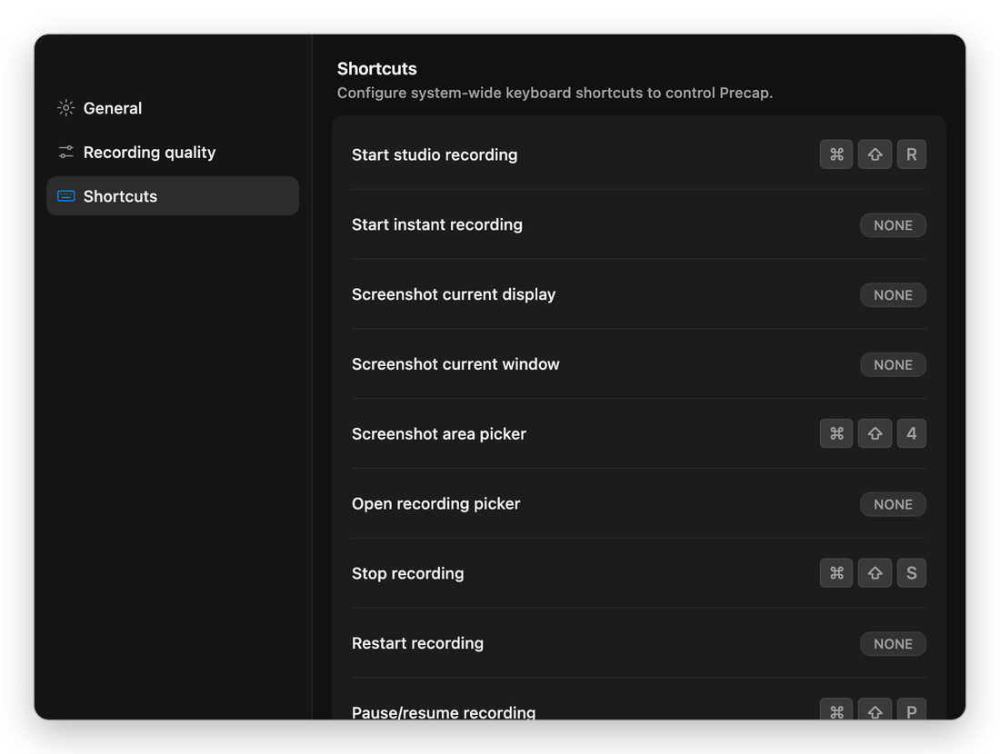

<div align="center">

# Precap

**A studio-style screen recorder for macOS, Windows and Linux, written in Rust.**

Record your screen, camera, microphone and system audio. Polish the result in an editor with
live preview, then export a video that looks produced, not just captured.

[](LICENSE)




</div>

## Contents

- [Features](#features)
- [Screenshots](#screenshots)
- [Platform support](#platform-support)
- [Install](#install)
- [Usage](#usage)
- [Project format](#project-format)
- [How it works](#how-it-works)
- [Development](#development)
- [Not included yet](#not-included-yet)
- [License](#license)

## Features

**Three recording modes**

- **Studio:** every source is recorded to its own file (screen, camera, mic, system audio, plus
  cursor movement and clicks), so everything stays editable afterwards. Each pause starts a new
  segment.
- **Instant:** stop recording and get a finished MP4 straight away, with the camera bubble baked in
  where it sat on screen. The file is copied to your clipboard, ready to paste into a chat or an email.
  Everything stays on your machine; nothing is uploaded.
- **Screenshot:** capture a display, a window or an area, then annotate it. Text in the screenshot
  can be selected and copied, like Live Text.

**Recording**

- Record a whole display, one window or a region you drag out
- Camera bubble: round or rounded square, mirrored, placed anywhere on screen, with live background blur or removal on macOS that Studio projects keep
- Microphone with a live level meter, and system audio
- A countdown, plus a warning before you record without a microphone
- A teleprompter that stays out of the recording (macOS)
- A floating controls bar to stop, pause, restart or delete the recording
- Low-disk guard: won't start without room, and pauses (rather than corrupts) a recording when the disk fills up
- Crash recovery: a recording cut off by a crash shows up as *Incomplete Recording* with **Recover...** and **Discard**
- A first-run permissions window for screen recording, microphone, camera and accessibility (macOS)

**Video editor with live preview**

- Backgrounds: wallpapers, your own images, solid colours or gradients
- Padding, rounded or squircle corners, and shadow
- Camera bubble position, size and shape, plus background blur (light or heavy) or removal (macOS, Apple Vision)
- A smoothed cursor (spring physics) that you can resize or hide
- Timeline: split clips, cut, change speed, add zooms by hand or automatically from your clicks;
  zooms follow the cursor
- Mic and system-audio volume, noise reduction and loudness normalisation
- Wide, vertical, square and classic aspect ratios
- Undo and redo; export to MP4 or GIF

**Screenshot editor**

- Draw, arrow, rectangle, circle and text tools, a mask that blurs or pixelates, and layers
- Crop, aspect ratio, background, padding, rounding and shadow
- Copy to the clipboard or save as PNG; choose whether a new screenshot opens the editor, goes to the clipboard, or both

**Settings and shortcuts**

- Countdown, frame rate, recording quality presets, Instant resolution (720p to 4K)
- Recordings folder and a project-name template (`{target_name} {date} {time}` and friends)
- Windows to leave out of recordings (macOS)
- System-wide shortcuts for all 13 recording and screenshot actions

**Command line**

- Record, preview frames, auto-zoom and export from a terminal or a script. See [Usage](#usage).

**Opens Cap projects**

- Precap reads the same `recording-meta.json`, `cursor.json` and `project-config.json` files as
  Cap's studio mode, so it can also export studio recordings made with Cap.

## Screenshots

<table>
  <tr>
    <td align="center" width="50%"><br><sub>The recorder: pick a mode, what to record, camera and mic</sub></td>
    <td align="center" width="50%"><br><sub>The screenshot editor, with annotations and a background</sub></td>
  </tr>
  <tr>
    <td align="center"><br><sub>Recording controls</sub></td>
    <td align="center"><br><sub>After an Instant recording: already on the clipboard</sub></td>
  </tr>
  <tr>
    <td align="center"><br><sub>Settings</sub></td>
    <td align="center"><br><sub>Global shortcuts</sub></td>
  </tr>
</table>

## Platform support

| | macOS 14+ | Windows 10/11 | Linux (X11) |
|---|---|---|---|
| **Status** | Built and tested | Compiles; not yet tested on a real machine | Recording tested under Xvfb; settings, shortcuts and selectable text not yet tested |
| **Screen and window capture** | ScreenCaptureKit | gdigrab | x11grab (no Wayland) |
| **Camera and mic** | AVFoundation | DirectShow | V4L2 and PulseAudio |
| **System audio** | ScreenCaptureKit | A loopback input such as "Stereo Mix" or VB-CABLE | PulseAudio/PipeWire monitor |
| **Selectable text** | Apple Vision | Windows OCR | `tesseract`, if installed |
| **Keeps its own windows out of the recording** | Yes | Marked for exclusion (untested) | No (X11 can't) |
| **Editor webview** | WKWebView | WebView2 (preinstalled) | WebKitGTK |

## Install

There are no prebuilt downloads yet, so build Precap from source.

### 1. Prerequisites

- **Rust 1.90 or newer**, from [rustup.rs](https://rustup.rs)
- **ffmpeg and ffprobe** on your `PATH`; they do the capture, decoding and encoding:
  - macOS: `brew install ffmpeg`
  - Windows: `winget install Gyan.FFmpeg`
  - Linux: `sudo apt install ffmpeg`
- **macOS:** Xcode Command Line Tools (`xcode-select --install`)
- **Windows:** the MSVC build tools ("Desktop development with C++" in the Visual Studio Installer)
- **Linux:** the build and runtime packages:

  ```sh
  sudo apt install pkg-config libx11-dev libxcb1-dev libxcb-randr0-dev \
    libwebkit2gtk-4.1-dev libssl-dev librsvg2-dev
  sudo apt install xclip tesseract-ocr   # optional: clipboard (or wl-copy) and selectable text
  ```

### 2. Build and run

```sh
git clone https://github.com/EmmanuelOluwafemi/precap.git
cd precap
cargo build --release
./target/release/precap
```

### 3. macOS permissions

On first use macOS asks for **Screen Recording**, **Camera** and **Microphone** access, and
**Accessibility** for cursor tracking. Precap runs as a plain binary rather than an `.app` bundle,
so macOS asks on behalf of the app you started it from, such as Terminal or iTerm. Grant access in
System Settings → Privacy & Security, then start Precap again.

## Usage

### The recorder

Run `precap` with no arguments to open the recorder.

1. Pick a mode: Instant, Studio or Screenshot.
2. Pick what to record (display, window or area) and turn the camera, mic and system audio on or off.
3. Start. Stop with the controls bar or your shortcut.

What happens next depends on the mode. A Studio recording opens in the editor (or in a small card,
if you choose that in Settings). An Instant recording is turned into an MP4 and copied to your
clipboard. A screenshot opens in the screenshot editor.

**Where files go:** recordings and screenshots are saved in the app data folder, unless you pick
another folder in Settings:

| OS | Folder |
|---|---|
| macOS | `~/Library/Application Support/dev.precap.editor/` |
| Windows | `%APPDATA%\dev.precap.editor\` |
| Linux | `~/.local/share/dev.precap.editor/` |

Studio recordings go in `recordings/` and screenshots in `screenshots/`, each as a `<name>.cap`
folder. Settings are saved as `settings.json` in the same app data folder. Exported videos go to
Movies (Videos on Windows and Linux), and saved PNGs to Pictures.

### Command line

```sh
precap devices                                    # list screens, cameras and microphones
precap record demo.cap --display 0 --camera --mic # Enter pauses/resumes; q then Enter stops
precap edit demo.cap                              # open the editor with live preview
precap auto-zoom demo.cap                         # add zooms around recorded clicks
precap preview demo.cap --at 5 --out frame.png    # render one frame to check an edit
precap export demo.cap --out demo.mp4 --height 1080 --fps 30
precap screenshot "My shot.cap"                   # open the screenshot editor
```

Auto-zoom adds a zoom around each click: it starts 0.4 s before the click and holds for 1.5 s, and
clicks less than 1 s apart share one zoom.

### Wallpapers

The editors' Wallpaper tab appears once wallpapers exist. They're original images made with
OpenAI's image API, using your own API key and credits:

```sh
export OPENAI_API_KEY=sk-...          # or put OPENAI_API_KEY=... in ~/.config/precap/openai.env
python3 tools/gen-wallpapers.py       # 36 images in 6 categories; reruns only fill gaps
cargo build --release                 # wallpapers are built into the app
```

## Project format

A Studio recording is a folder: `recording-meta.json` lists the tracks of each segment (screen,
camera, mic, system audio, cursor), and `project-config.json` holds every edit. The editor writes
the config for you, but you can also edit it by hand and run `precap export`.

<details>
<summary><code>project-config.json</code> reference</summary>

```jsonc
{
  "aspectRatio": null,              // or "wide" | "vertical" | "square" | "classic"
  "background": {
    "source": { "type": "gradient", "from": [71,59,214], "to": [233,119,163], "angle": 135 },
    // or { "type": "color", "value": [r,g,b] } / { "type": "image", "path": "/abs/file.jpg" }
    //    / { "type": "wallpaper", "path": "wallpapers/dark/1.jpg" }
    "padding": 8, "rounding": 8, "roundingType": "squircle",
    "shadow": 60, "advancedShadow": { "size": 50, "opacity": 18, "blur": 50 }
  },
  "camera": { "hide": false, "mirror": false, "position": { "x": "right", "y": "bottom" },
              "manualPosition": null, "size": 25, "rounding": 100 },
  "cursor": { "hide": false, "size": 100, "raw": false, "tension": 470, "mass": 3, "friction": 70 },
  "audio": { "mute": false, "improve": true, "micVolumeDb": 0, "systemVolumeDb": 0 }, // -30 dB or lower = muted
  "screenMovementSpring": { "stiffness": 200, "damping": 40, "mass": 2.25 },
  "timeline": {
    "segments": [ { "recordingSegment": 0, "timescale": 1.0, "start": 0, "end": 12.5 } ],
    "zoomSegments": [ { "start": 3, "end": 6, "amount": 2.0, "mode": "auto" } ]
  }
}
```

`timeline.segments` is the cut list. It plays slices of the recording's segments in order, and
`timescale: 2` doubles the speed. A zoom's `mode` is `"auto"` (follow the cursor) or
`{ "manual": { "x": 0.3, "y": 0.6 } }`.

</details>

## How it works

- **Capture:** each source goes to its own file in `<name>.cap/content/segments/segment-N/`. On
  macOS the screen and system audio come from ScreenCaptureKit; on Windows and Linux, ffmpeg captures
  the screen. ffmpeg also records the camera and mic everywhere. Cursor positions and clicks are
  sampled into `cursor.json`.
- **Rendering:** a Rust renderer composites each output frame in parallel: background, rounded
  mask, shadow, camera bubble, smoothed cursor and the zoom spring. ffmpeg encodes the result. The
  editor's preview uses the same renderer, so what you see is what you export.
- **Instant:** a single ffmpeg pass per segment bakes in the camera bubble and mixes the audio, so
  the MP4 is ready a few seconds after you stop.
- **UI:** plain HTML, CSS and JavaScript pages in a [Tauri 2](https://tauri.app) webview, with no
  framework and no frontend build step. Each editor runs as its own process.

## Development

```sh
cargo test                # unit tests (needs ffmpeg)
cargo test -- --ignored   # live tests
```

The live tests capture your real screen and system audio and briefly open the microphone, so run
them when that's fine.

| Path | What's there |
|---|---|
| `src/main.rs` | Command-line entry point |
| `src/record.rs`, `src/sck.rs`, `src/oswin.rs` | Capture: devices, windows, screen/camera/audio, screenshots |
| `src/recorder.rs` | The recorder app: windows, recording state, shortcuts, settings commands |
| `src/editor.rs`, `src/screenshot.rs` | Backends for the video editor and the screenshot editor |
| `src/render.rs`, `src/export.rs` | Frame compositing and MP4 export |
| `src/instant.rs`, `src/autozoom.rs`, `src/ocr.rs` | Instant MP4s, zooms from clicks, selectable text |
| `src/project.rs`, `src/settings.rs`, `src/os.rs` | Project files, settings, clipboard and file helpers |
| `ui/` | Every window's page (recorder, controls, editor, screenshot editor, settings and more) |
| `tools/gen-wallpapers.py` | Generates the built-in wallpapers |

## Not included yet

- Accounts, cloud upload and share links (Instant is local only)
- Camera background blur on Windows and Linux, and in Instant recordings
- Captions and transcription
- Keyboard overlay
- Text, mask and scene tracks in the video editor
- Motion blur
- Multi-monitor cursor mapping
- Prebuilt, signed downloads

## License

[MIT](LICENSE) © 2026 Emmanuel Yusuf

Precap is an independent project. It is not affiliated with, endorsed by or connected to Cap or
its makers. It was inspired by Cap's studio mode and reads its project format so you can open
recordings made with it.
